# ConstructTrack

**Automated Construction Progress Monitoring, Delay Prediction & Risk Reporting System**

A web-based system that tracks construction-site progress from real project data and site photographs, analyses that photographic evidence with computer vision, and turns the combined data into explainable schedule-risk predictions and professional progress reports.

| | |
|---|---|
| **Course** | Minor Project (ES-451), B.Tech Information Technology, 7th semester, 2026–27 |
| **Institute** | Maharaja Agrasen Institute of Technology, Delhi (GGSIPU) |
| **Team 54** | Ashish Upadhyay (06714803123) · Yash Rajput (06814803123) · Sahil Rao (07614803123) |
| **Faculty guide** | Dr. Seema Kalonia |
| **Live demo** | _add your Vercel URL here_ |

## Contents

- [Overview](#overview) · [Features](#features) · [System Workflow](#system-workflow) · [Architecture](#architecture)
- [AI/ML Pipeline](#aiml-pipeline) · [Progress Analytics](#progress-analytics) · [Delay Prediction & Risk Analysis](#delay-prediction--risk-analysis) · [Automated Reporting](#automated-reporting)
- [Evaluation](#evaluation) · [Technology Stack](#technology-stack) · [Project Structure](#project-structure)
- [Getting Started](#getting-started) · [Deployment](#deployment) · [API Overview](#api-overview) · [Testing](#testing)
- [Security](#security-considerations) · [Limitations](#known-limitations) · [Future Scope](#future-scope) · [Documentation](#documentation)

## Overview

ConstructTrack centralises the information a construction project manager already collects — periodic planned-vs-actual progress updates and site photographs — and builds three analytical capabilities on top of it:

- **Computer-vision analysis** of uploaded site images with a YOLO11 object-detection model, kept strictly as supporting visual evidence and never used as a measure of completion.
- **Progress analytics** that compare recorded progress with the planned schedule and compute a trend over real elapsed time.
- **Delay prediction and risk scoring** that project a likely completion date and a documented, deterministic 0–100 schedule-risk score from the project's own progress history, and that refuse to predict when there is not enough data.

Everything is consolidated into an automated project report, viewable on the web, printable, and exportable as a PDF. No metric is ever accepted from the client: every progress percentage, risk score and predicted date is computed on the server from the database.

The system consists of two independently deployable services: a Next.js application (UI, API, database access) and a Python FastAPI service (YOLO11 inference). For the formal synopsis, see [`docs/project-synopsis.md`](docs/project-synopsis.md).

## Features

- **Project management** — create, edit and delete construction projects with a planned schedule (start date, expected end date), status and location.
- **Progress tracking** — record periodic planned-vs-actual observations, with automatically derived deviation and status (ahead / on track / at risk / delayed).
- **Construction image management** — upload site photographs (JPEG/PNG/WEBP), optionally linked to a specific progress record; stored in a private bucket and served through short-lived signed URLs; gallery, timeline and side-by-side comparison views. Large phone photos are downscaled in the browser before upload.
- **Computer-vision analysis** — run YOLO11 object detection on an uploaded image and persist the structured result (detected objects, counts, confidence scores, annotated image).
- **Progress analytics** — current completion, planned-vs-actual variance and an elapsed-time progress trend, plus AI detection-count trends over time.
- **Delay prediction** — estimated completion date, predicted delay in days and an "Estimated Delay Probability" heuristic, with explicit "insufficient data" handling.
- **Risk analysis** — a documented, weighted 0–100 Schedule Risk Score with LOW / MODERATE / HIGH / CRITICAL bands and factor-level explanations.
- **Automated reporting** — a structured project report generated from a single project ID and stored as a snapshot.
- **PDF export** — a genuine, server-rendered PDF of the same report.
- **Dashboard** — portfolio view of total/active projects, average completion and at-risk projects.
- **Cloud deployment** — live web app on Vercel with Supabase (PostgreSQL + storage) and automatic database migrations; the YOLO11 service is containerised with Docker and run self-hosted, protected by an optional API key.

## System Workflow

```text
Create Project
      ↓
Record Progress
      ↓
Upload Construction Images
      ↓
Run AI Analysis
      ↓
Review Progress Analytics
      ↓
Review Delay Prediction
      ↓
Review Risk Analysis
      ↓
Generate Report
      ↓
View / Print / Download PDF
```

1. **Create Project** — register a project with its name, location, planned start date, and expected end date.
2. **Record Progress** — log a periodic planned-vs-actual progress observation; deviation and status are derived automatically.
3. **Upload Construction Images** — attach dated site photographs to the project, optionally tied to a specific progress record.
4. **Run AI Analysis** — trigger YOLO11 object detection on an image; results (detected objects, counts, confidence) are persisted.
5. **Review Progress Analytics** — see current completion, variance against plan, and the historical trend computed from real elapsed time between records.
6. **Review Delay Prediction** — see the estimated completion date, predicted delay, and delay-probability heuristic derived from the project's own progress velocity.
7. **Review Risk Analysis** — see the 0–100 schedule risk score, its risk band, and the underlying factor explanations.
8. **Generate Report** — request a report for the project; every value in it is computed server-side from the current database state.
9. **View / Print / Download PDF** — review the report on the web (print-friendly), or download it as a PDF.

## Architecture

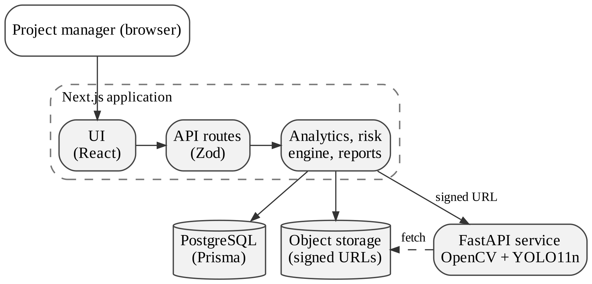

```text
Construction Project → Progress Data → Site Images → YOLO11 Analysis (visual evidence)
                                   ↓
                       Progress Analytics → Delay Prediction → Risk Analysis
                                   ↓
                         Report Builder → Web Report / PDF
```

- **`web/`** — Next.js 15 (App Router) application. Owns the UI, the API routes, database access (Prisma) and Supabase Storage integration. Calls the AI service over HTTP and never runs Python itself.
- **`ai-service/`** — FastAPI application. Owns image preprocessing and YOLO11 inference. Stateless: it receives a short-lived signed image URL and returns structured detection JSON; it never talks to PostgreSQL or Supabase directly. An optional shared secret (`X-API-Key`) protects it when publicly hosted.

Within `web/`, API routes validate input (Zod) and delegate to service functions; services do the database work and call pure, independently tested analytics engines (progress analytics, delay prediction, report composition). The dashboard, API and report all use the same engine functions, so they always show identical numbers, and the web report and PDF render the same stored `ReportData` snapshot.

## AI/ML Pipeline

Construction images are analyzed by a real YOLO11 (Ultralytics) object-detection model running in the Python AI service — this is genuine inference, not a simulated or hard-coded result. The pipeline:

1. The web app generates a short-lived, signed URL for the uploaded image (never a permanent one, and no storage credentials leave the Next.js server).
2. The AI service downloads the image, decodes and validates it (magic-byte sniffing, not just `Content-Type`), and resizes it for inference.
3. YOLO11 runs real object detection and returns detected objects, per-detection confidence and bounding boxes, and aggregate object counts.
4. The result is persisted against the image (`AIAnalysis`), and an annotated copy of the image (with detection boxes drawn) is optionally stored alongside the original.

**What this analysis is, and is not.** YOLO11 here is a general-purpose, COCO-pretrained detector — it recognizes common object classes (people, vehicles, equipment, and similar), not construction-specific concepts such as "wall completed" or "roof installed." Detected-object counts are treated throughout the system as **visual evidence only**: they are shown alongside progress data for a human reviewer's context, but they never feed into, or are converted into, a construction-completion percentage, a progress metric, or the delay/risk calculations described below. Every screen and report section that displays AI detections carries an explicit label to that effect.

No formal accuracy benchmark (precision/recall against labeled construction-site data) exists for this deployment — YOLO11's published performance is a general-purpose COCO benchmark, not a construction-specific one, and no such claim is made by this system.

Full pipeline details are documented in [`docs/ai-pipeline.md`](docs/ai-pipeline.md).

## Progress Analytics

Progress analytics are computed from a project's own recorded `ProgressRecord` history (planned and actual progress percentages, recorded per observation date). For each project, the system calculates:

- **Current completion** — the most recent recorded actual and planned progress values.
- **Variance** — `actualProgress − plannedProgress` on the latest record, and a derived status (ahead / on track / at risk / delayed).
- **Historical trend** — an average progress gain over real elapsed calendar time between the earliest and latest records with a recorded actual value (not an assumed weekly cadence).

With fewer than two progress records carrying an actual value, the trend is reported as unavailable with an explicit reason rather than an estimated number. Historical results are presented as a chronological table (date, planned, actual, variance, status) and a planned-vs-actual line chart.

See [`docs/progress-monitoring.md`](docs/progress-monitoring.md) for the full methodology.

## Delay Prediction & Risk Analysis

Delay prediction and risk scoring are computed by a single, deterministic, rule-based engine — there is no trained machine-learning model behind these numbers, and this is stated explicitly wherever they are shown. Using a project's own schedule dates and progress-record history, the engine computes:

- **Estimated completion date** — projected from the real elapsed-time progress velocity between recorded updates.
- **Predicted delay (days)** — the gap between the estimated and expected completion dates, always reported as a non-negative value alongside a separate schedule outcome (early / on track / delayed).
- **Estimated Delay Probability** — a documented, weighted heuristic (schedule variance, velocity, and historical trend), explicitly labeled as a deterministic indicator, not a statistically validated probability model.
- **Schedule Risk Score** — a documented, weighted 0–100 score (schedule variance, velocity adequacy, predicted schedule delta, and historical trend), banded as LOW (0–24) / MODERATE (25–49) / HIGH (50–74) / CRITICAL (75–100).
- **Data sufficiency** — INSUFFICIENT / LIMITED / ADEQUATE / STRONG, based on how many usable progress records back the prediction. With fewer than two usable records, no prediction, risk score, or completion date is computed at all — the system reports insufficient data rather than a guess.

YOLO11 detection counts, where available, appear only as an optional, clearly-labeled factual note (e.g. a detection-count change between two analyzed images) — they are never an input to the risk score or delay projection. The full methodology, including the exact weighting formulas and a worked example, is documented in [`docs/delay-prediction.md`](docs/delay-prediction.md).

## Automated Reporting

A report is generated from a single request containing only a `projectId` — every value inside it (progress figures, image/analysis counts, delay prediction, risk score) is retrieved from the database and computed server-side by the same progress-analytics and delay-prediction engines described above; the client can never submit a calculated metric. Each report is persisted as a structured snapshot (`Report.reportData`), so the report history for a project reflects what the system actually reported at that point in time. Reports can be viewed as a formatted web page (print-friendly), and downloaded as a genuine PDF built with PDFKit, containing the same sections in the same order — report header, executive summary, project overview, progress analytics and history, construction image summary, AI computer-vision analysis, delay prediction, risk analysis, methodology, and limitations/disclaimer. The PDF is text/table-based; it does not currently embed the progress chart. See [`docs/reporting.md`](docs/reporting.md) for the full report architecture.

## Evaluation

The delay and risk engine is evaluated on structured scenarios against a deviation-only baseline, checked for determinism, and tested for sensitivity to its weights. Every number below is reproduced by:

```bash
cd web
npm run evaluate
```

| Scenario | Usable records | Deviation | Velocity ratio | Predicted delay | Risk score (band) | Deviation-only baseline |
|---|---|---|---|---|---|---|
| Office, slipping | 5 | −10 | 0.67 | 70 days | 72 (HIGH) | MEDIUM |
| Tower, on plan | 4 | −1 | 1.00 | 2 days | 23 (LOW) | LOW |
| Retail, ahead | 3 | +6 | 1.33 | 0 (21 days early) | 10 (LOW) | LOW |
| Annex, stalled | 4 | −21 | 0.30 | 321 days | 91 (CRITICAL) | CRITICAL |
| Single record | 1 | −2 | — | — | withheld (insufficient data) | LOW |
| Exact pace | 2 | 0 | 1.00 | 0 | 15 (LOW) | LOW |

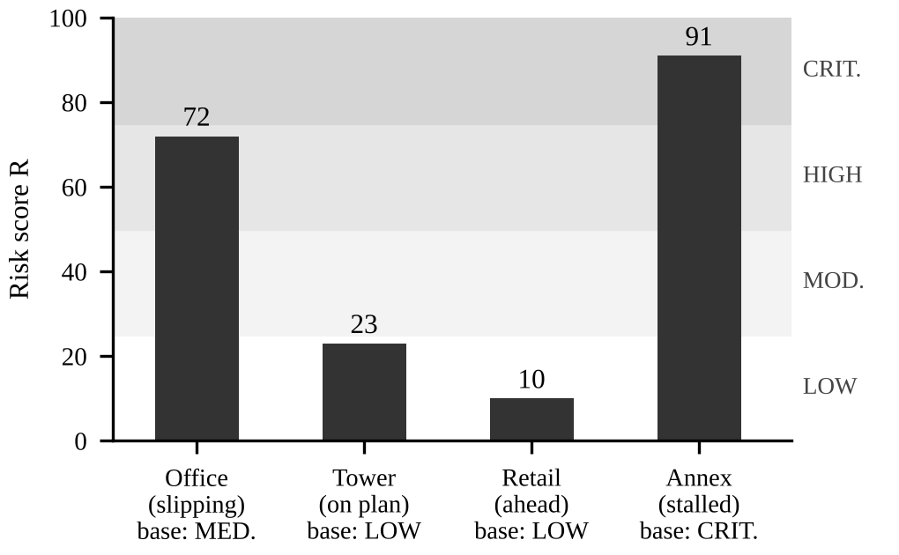

- The slipping office is rated **HIGH** (70-day projected overrun) where the deviation-only rule says MEDIUM: its pace is two-thirds of what is required and its deviation is widening.
- With a single record, the engine **withholds** a prediction; the baseline still labels it.
- **Determinism:** 1,000 repeated runs give identical output.
- **Weight sensitivity:** ±20% changes to any single weight change no band (0/32 cases). Over 10,000 random ±30% weight sets, scores shift at most 5 points and the ranking of the four projects is preserved every time; band changes (4.6%) occur only for the on-plan tower, whose score sits just below the LOW/MODERATE boundary.

These results show consistency and interpretability, not forecast accuracy — calibrating against real project outcomes is future work. The demo seed data (`npm run db:seed`) uses the same four project scenarios.

## Technology Stack

| Layer | Technologies |
|---|---|
| Frontend | Next.js 15 (App Router), React 19, TypeScript, Tailwind CSS 4, shadcn/ui (Radix UI), Recharts |
| Backend | Next.js API routes, Zod validation, Prisma ORM 6, PostgreSQL |
| Storage | Supabase Storage (private bucket, short-lived signed URLs) |
| AI / Computer vision | Python, FastAPI, YOLO11 (Ultralytics), OpenCV (headless), PyTorch, NumPy, Pandas |
| Reporting | PDFKit (server-side PDF generation) |
| Testing | Node test runner via `tsx`, pytest, ESLint, TypeScript strict mode |
| Deployment | Vercel (web), Supabase (database + storage), Docker / self-hosted (AI service) |

## Project Structure

```text
web/                          Next.js application
├── app/
│   ├── (dashboard)/            Dashboard, projects and reports pages
│   └── api/                    projects, progress, images, analysis, delay,
│                               delay-prediction, reports (+ PDF)
├── components/                 UI primitives, layout, project sections,
│                               construction images, reports
├── lib/
│   ├── api/                    Shared API error/response helpers
│   ├── validation/             Zod schemas per resource
│   ├── services/               Business logic, analytics engines (+ tests)
│   ├── serializers/            JSON-safe response shapes
│   ├── reports/                Report contract, formatting, PDF renderer
│   ├── images/                 Upload constants, queue, client-side compression
│   └── supabase/               Supabase Storage clients
├── prisma/                     schema.prisma, migrations, seed.ts (demo data)
├── scripts/
│   └── evaluate-risk-engine.ts Reproduces the evaluation results
└── package.json

ai-service/                   Python FastAPI service
├── app/                        main.py, config, routes, services, schemas
├── tests/                      pytest suite (32 tests)
├── Dockerfile                  CPU-only image for any Docker host
├── hf-space-README.md          Optional metadata for hosting on a Hugging Face Space (paid tier)
└── requirements.txt

docs/                         Synopsis, methodology, deployment guide, figures
.env.example                  Environment variable reference
```

## Getting Started

### Prerequisites

- Node.js 20+ and npm
- Python 3.10+
- A PostgreSQL database (local or hosted)
- A Supabase project (for image storage)

### Installation

```bash
# Web application
cd web
npm install            # also generates the Prisma Client

# AI service
cd ../ai-service
python3 -m venv .venv
source .venv/bin/activate   # Windows: .venv\Scripts\activate
pip install -r requirements.txt
```

### Environment Variables

```bash
cp .env.example web/.env                  # web app
cp ai-service/.env.example ai-service/.env  # AI service (optional)
```

| Variable | Used by | Purpose |
|---|---|---|
| `DATABASE_URL` | web | PostgreSQL connection string |
| `NEXT_PUBLIC_SUPABASE_URL` | web | Supabase project URL (safe for the browser) |
| `NEXT_PUBLIC_SUPABASE_ANON_KEY` | web | Supabase anon key (safe for the browser) |
| `SUPABASE_SERVICE_ROLE_KEY` | web | Server-side only — never exposed or committed |
| `AI_SERVICE_URL` | web | Base URL of the AI service, e.g. `http://localhost:8000` |
| `AI_SERVICE_API_KEY` | web | Optional; sent as `X-API-Key` to the AI service |
| `SERVICE_API_KEY` | ai-service | Optional; when set, `/api/v1/analyze` requires the matching key |

A Supabase Storage bucket named exactly `construction-images` must exist and be **private**.

### Database Setup

`DATABASE_URL` must point at a real, reachable PostgreSQL server before
running the commands below — Prisma does not create the server itself,
only the schema inside it. If you don't already have a PostgreSQL server
for local development, the quickest path on macOS is Homebrew:

```bash
brew install postgresql@16
brew services start postgresql@16
createdb construction_progress
```

Then set `DATABASE_URL` in `web/.env` to match, using your local macOS
username (Homebrew's default Postgres has no password for local
connections):

```env
DATABASE_URL="postgresql://YOUR_MACOS_USERNAME@localhost:5432/construction_progress?schema=public"
```

(Any other local install, Postgres.app, Docker, or a hosted provider works
the same way — just make sure `DATABASE_URL` matches a database that
actually exists and is reachable.)

Once the database exists and `DATABASE_URL` is correct:

```bash
cd web
npm run db:generate    # generates the Prisma Client
npm run db:migrate     # creates tables from prisma/schema.prisma
npm run db:seed        # loads demo projects and progress history
```

### AI Service Setup

```bash
cd ai-service
source .venv/bin/activate
uvicorn app.main:app --reload --port 8000
```

Interactive API docs: `http://localhost:8000/docs`.

### Running the Application

```bash
cd web
npm run dev
```

Open `http://localhost:3000`.

## Deployment

The web application is live on **Vercel** with **Supabase** (PostgreSQL + private image storage), both on free tiers: **https://construct-track-pi.vercel.app**. In Vercel the Root Directory is `web`; the `vercel-build` script runs `prisma generate`, `prisma migrate deploy` and `next build`.

The **YOLO11 AI service** (PyTorch + Ultralytics) is too large for serverless functions, and free Docker hosting on Hugging Face Spaces became a paid feature in 2026, so the service is **self-hosted**: it runs on the team's machine (or any Docker host, using the included `Dockerfile`). Because the local app and the live app share the same Supabase database, every analysis result is stored centrally and is visible on the live site at any time. Step-by-step instructions are in [`docs/DEPLOYMENT.md`](docs/DEPLOYMENT.md).

## API Overview

All routes return a consistent JSON envelope: `{ "success": true, "data": ... }` on success, or `{ "success": false, "error": { "code", "message" } }` on failure.

| Method | Route | Purpose |
|---|---|---|
| `GET` | `/api/projects` | List all projects with summary counts. |
| `POST` | `/api/projects` | Create a project. |
| `GET` | `/api/projects/:id` | Get full project detail, including progress history. |
| `PATCH` | `/api/projects/:id` | Update a project. |
| `DELETE` | `/api/projects/:id` | Delete a project (cascades its progress, images, and reports). |
| `GET` | `/api/progress?projectId=` | List a project's progress records. |
| `POST` | `/api/progress` | Create a progress record (deviation/status derived server-side). |
| `PATCH` | `/api/progress/:id` | Update a progress record. |
| `DELETE` | `/api/progress/:id` | Delete a progress record. |
| `GET` | `/api/images?projectId=` | List a project's construction images with signed URLs. |
| `POST` | `/api/images` | Upload a construction image (`multipart/form-data`: `file`, `projectId`, optional `progressRecordId`). |
| `DELETE` | `/api/images/:id` | Delete an image (storage object + database record). |
| `GET` | `/api/analysis?constructionImageId=` | Get the current AI-analysis status/result for one image. |
| `POST` | `/api/analysis` | Run YOLO11 analysis on an already-uploaded image. |
| `POST` | `/api/delay` | Per-record baseline delay estimate (deviation-only). |
| `GET` | `/api/delay-prediction?projectId=` | Get the current delay prediction and schedule risk assessment for a project. |
| `GET` | `/api/reports?projectId=` | List reports (optionally scoped to a project). |
| `POST` | `/api/reports` | Generate a new report (`{ "projectId": "..." }` — no other field is accepted). |
| `GET` | `/api/reports/:id` | Get one report's full stored snapshot. |
| `GET` | `/api/reports/:id/pdf` | Download that report as a PDF file. |

## Testing

```text
npm test                        → 61/61 passing   (web: analytics, delay prediction, risk, reports, PDF)
npx tsc --noEmit                → 0 errors
npm run lint                    → 0 errors
npm run build                   → passes
npm run evaluate                → reproduces the evaluation tables
pytest -q                       → 32/32 passing   (AI service, incl. end-to-end YOLO11 inference)
```

Web unit tests (`node:test`) are co-located with the code under `web/lib/`; AI-service tests live in `ai-service/tests/`.

## Security Considerations

- The client can never submit a calculated metric (progress percentage, risk score, delay probability, predicted completion date, or detected-object counts) — every such value is computed server-side from the database on every request.
- The Supabase service-role key, database credentials, and AI-service internals are never exposed to the browser, in API responses, in report data, or in error messages.
- Construction images are stored in a private Supabase Storage bucket and served only via short-lived signed URLs, never a permanent public link.
- Uploaded files are validated server-side by content (magic-byte sniffing), not by trusted filename/`Content-Type`.
- API error responses follow one consistent, generic envelope — internal errors (database, unexpected exceptions) never leak stack traces, SQL details, or filesystem paths to the client.
- When publicly hosted, the AI service can require a shared `X-API-Key`; the key lives only in server-side environment variables.

## Known Limitations

- **No authentication or multi-tenancy** — single-tenant by design for this project's scope (see Future Scope).
- **PDF export is text/table-based** — it does not embed the progress chart.
- **No construction-specific detection benchmark** — YOLO11 is a general-purpose COCO-pretrained detector; no construction precision/recall evaluation has been performed.
- **Risk weights are reasoned, not fitted** — the evaluation demonstrates consistency and robustness, not forecast accuracy; no outcome dataset of completed projects exists yet.
- **Velocity is a two-point linear rate** — it does not model learning curves, weather or resource changes.

## Future Scope

- Authentication and multi-user, multi-organisation access control — started as **BuildBridge**, a multi-tenant evolution with organisations, roles, invitations and a tower → floor → stage progress model.
- Richer PDF reports with embedded charts.
- A labelled construction-image dataset, a formal detection benchmark and a construction-specific model (the detector already sits behind an adapter interface).
- Calibrating the risk weights, or fitting a statistical delay model, once completed-project outcome data is available.
- Automated alerts when a project enters a higher risk band.
- Integration with external project-management tools.

## Screenshots

Captured from the live deployment with the seeded demo projects (site photos are sample images generated for demonstration).

**Dashboard — portfolio KPIs and recent projects**

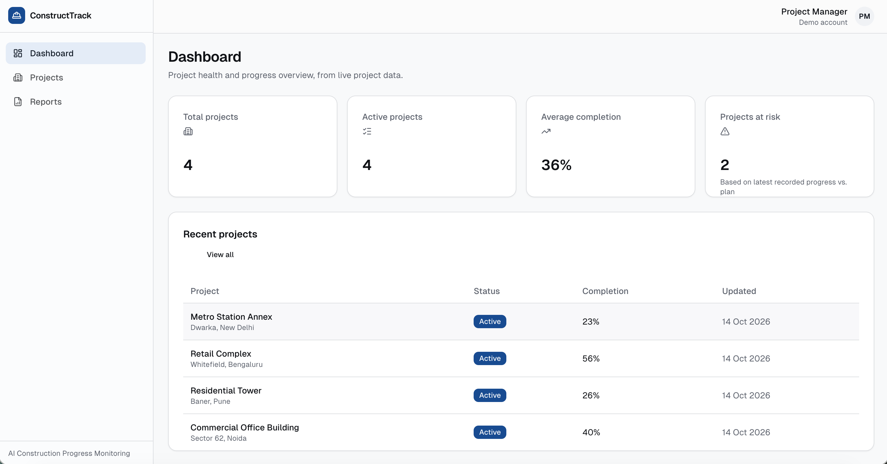

**Projects — status badges and completion**

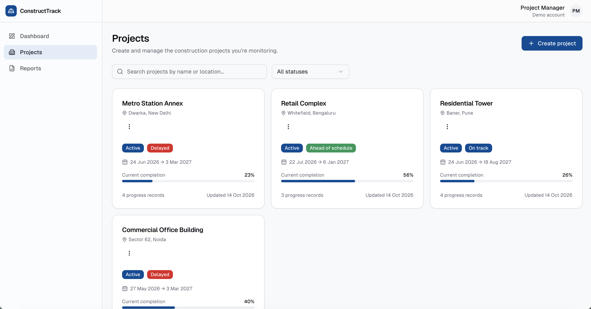

**Project detail — completion, plan, deviation and status**

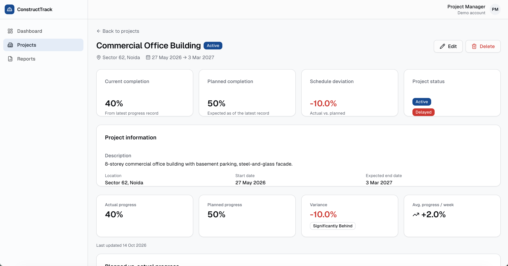

**Progress tracking — planned vs. actual chart and history**

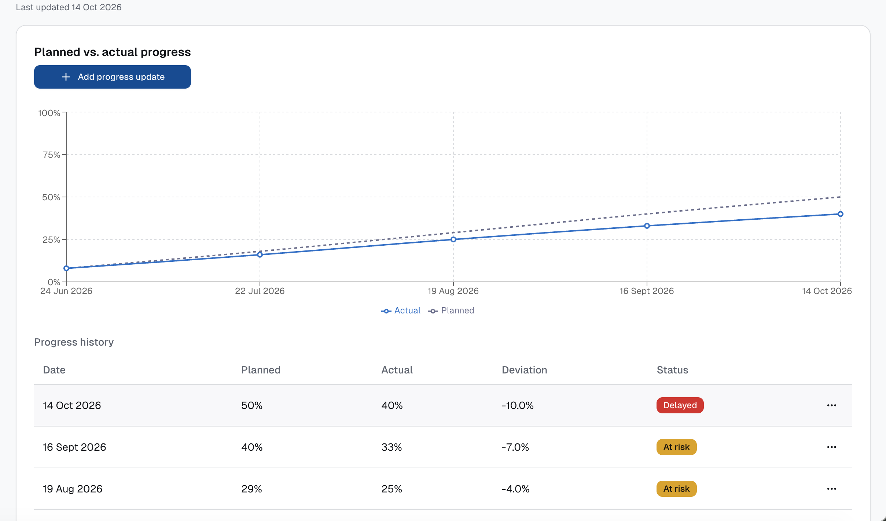

**Construction images — site photos over time**

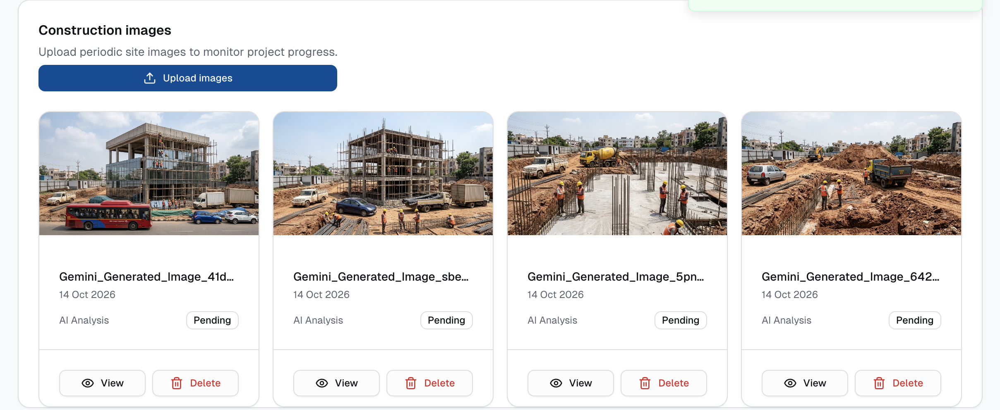

**Delay prediction — velocity, projected completion, prediction history**

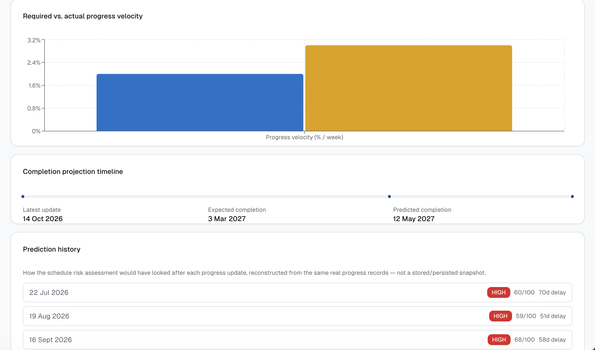

**Schedule risk — 72/100 HIGH with factor explanations**

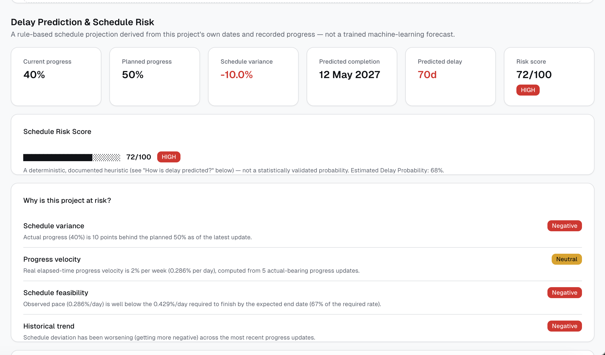

**Reports list**

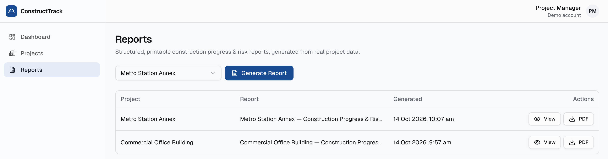

**Generated report — Metro Station Annex, 91/100 CRITICAL**

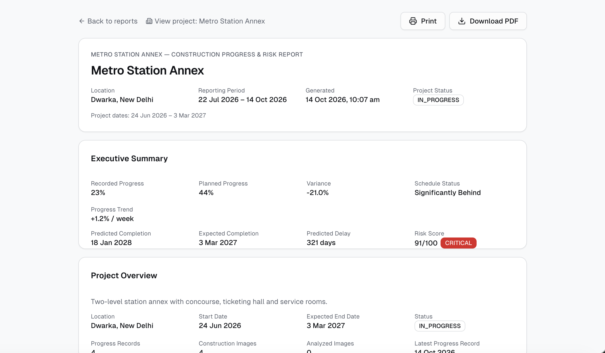

**Printable report layout**

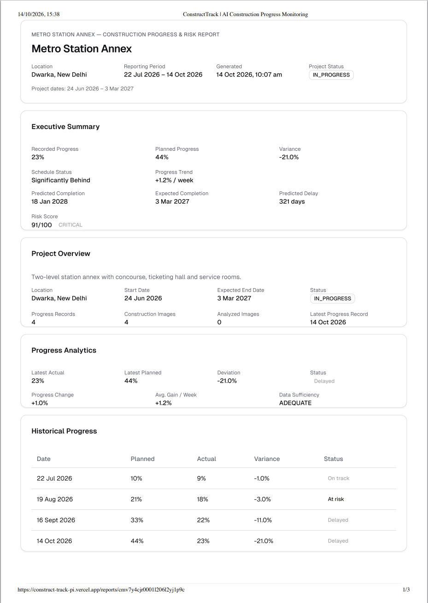

## Documentation

| Document | Contents |
|---|---|
| [`docs/project-synopsis.md`](docs/project-synopsis.md) | Abstract, problem statement, objectives, scope, stack, current status |
| [`docs/ai-pipeline.md`](docs/ai-pipeline.md) | Computer-vision pipeline and what YOLO11 can and cannot claim |
| [`docs/progress-monitoring.md`](docs/progress-monitoring.md) | Progress analytics methodology |
| [`docs/delay-prediction.md`](docs/delay-prediction.md) | Delay prediction and risk-score formulas, with a worked example |
| [`docs/reporting.md`](docs/reporting.md) | Report architecture and PDF export |
| [`docs/DEPLOYMENT.md`](docs/DEPLOYMENT.md) | Free-tier cloud deployment guide |

## Acknowledgment

Developed by Team 54 under the guidance of **Dr. Seema Kalonia**, Department of Information Technology, Maharaja Agrasen Institute of Technology, Delhi.
